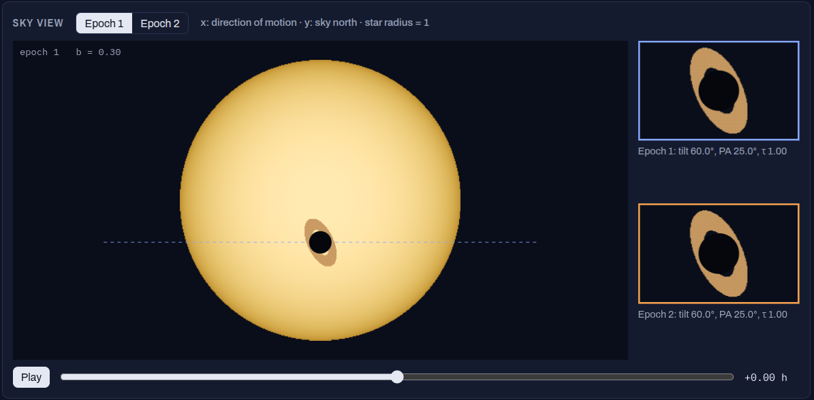

# Ringed Transit Simulator

[](https://doi.org/10.5281/zenodo.24099217)

Light-curve models of transiting exoplanets with rings.



- **`index.html`** — interactive browser simulator (single self-contained file, no build step).
  Open it directly or host via GitHub Pages. Includes ring geometry, optional exomoon,
  star spots, dust clump and dilution.
- **`ringed_transit.py`** — the Python model the web page is ported from.

## Physics

- Keplerian orbit (eccentric allowed): `P, t0, a/R*, i, e, omega`
- Quadratic limb darkening: `I(mu) = 1 - u1(1-mu) - u2(1-mu)^2`
- Opaque planet disk plus a flat, thin ring `[r_in, r_out]` (in planet radii) with normal
  optical depth `tau`, transmission `exp(-tau / |cos theta|)`; the planet hides the ring behind it
- Ring orientation given in the sky frame (`ring_incl`, `ring_pa`) or orbit frame (`obliquity`, `ring_azimuth`)
- Occulter rasterised once onto a grid (`n_grid` controls accuracy)

## Python usage

```bash
pip install -r requirements.txt
python ringed_transit.py      # runs the demos, writes mock_tess.* and mock_ground.*
```

```python
import numpy as np
import ringed_transit as rt

t = np.linspace(-0.3, 0.3, 2000)
flux = rt.light_curve(t, P=6.3, t0=0.0, a=16.0, inc=89.0, rp=0.10,
                      r_in=1.3, r_out=2.2, tau=0.8, ring_incl=72, ring_pa=25)
```

Also included: `simulate_lightcurve()` for realistic mock TESS / ground-based data
(stellar variability, flares, noise), `eb_light_curve()` for eclipsing-binary false
positives, and `generate_dataset()` for building labelled training sets.
